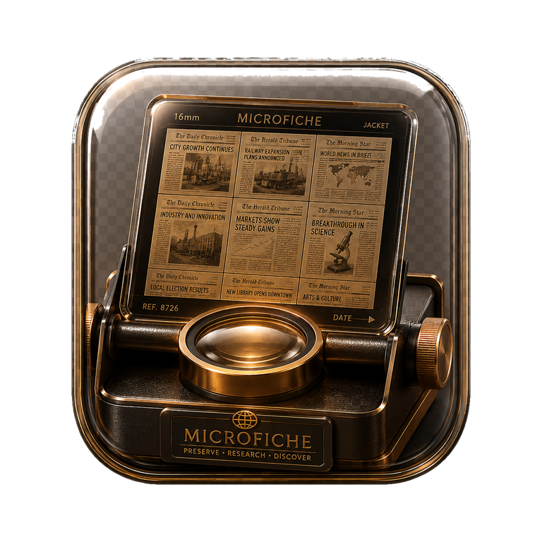
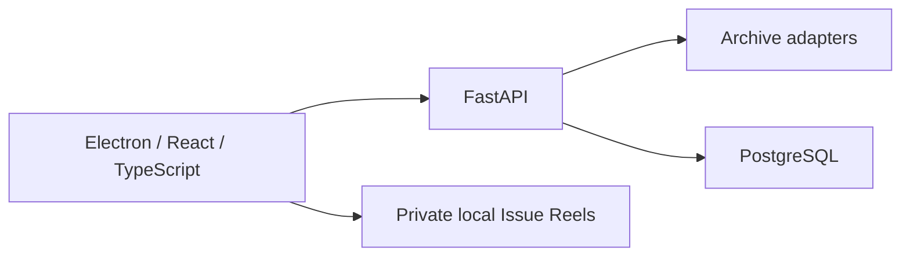

# Foxtail Microfiche

[](https://github.com/CDeSanto84/foxtail-microfiche-desktop/actions/workflows/checks.yml)

**A desktop research room for historical newspapers.**

Microfiche combines live archive search, a microfiche-inspired reader, and a
private cabinet for downloaded issues. It keeps provenance and access limits
visible while bringing several research workflows into one application.

## What works

- Concurrent search across Library of Congress Chronicling America, Internet
  Archive Newspapers, and DigitalNZ / Papers Past adapters.
- Progressive results, bounded retries, shared in-flight jobs, and a short
  metadata cache. A slow provider does not hold back results already received.
- A Newsstand catalog of 49 reviewed sources, with separate labels for live
  adapters, browser handoffs, subscriptions, and library access.
- Exact-issue routing by publication and date, plus a page reader with image
  adjustments, OCR where supplied, citations, and filmstrip navigation.
- Local Issue Reels from one downloaded PDF or ordered JPEG/PNG pages, with
  file-signature checks, isolated conversion, hashes, and stored provenance.

**Status:** v0.3, working development desktop. Production packaging, persisted
clippings/notes, and OCR for image-only imports are still planned.

## Architecture



Electron keeps Node integration off and context isolation on. The main process
owns archive navigation and file selection. Backend containers expose the API
on loopback; browser sessions and imported issues stay in local application data.
See [ARCHITECTURE.md](ARCHITECTURE.md) for the source boundaries.

## Run locally

Developed on Debian Linux. Requires Docker Engine with Compose, Node.js 22.12+
with npm, Poppler (`pdfinfo`, `pdftoppm`, `pdftotext`), ImageMagick 7 (`magick`),
`prlimit`, and Bubblewrap (`bwrap`) for Issue Reel conversion.

```bash
cp .env.example .env
# Replace the example database password in both password/connection settings.
./scripts/dev.sh
```

API health: <http://127.0.0.1:8787/api/v1/health>.
Stop the containers with `./scripts/stop.sh`. No imported newspapers, database
contents, browser profiles, or provider credentials are included in this repo.

## Checks

```bash
cd apps/desktop
npm ci
npm run check
```

Deterministic backend checks run with the API dependencies installed:

```bash
cd apps/api
python -m app.tests_smoke
python -m app.tests_reliability
```

The desktop checks cover TypeScript/build output, source URL boundaries, UI
contracts, and synthetic Issue Reel imports. Set
`MICROFICHE_REQUIRE_CONVERTER_SANDBOX=1` to require the production converter
sandbox in the import tests. Live-provider probes are separate and depend on
network access and provider availability.

## Research boundaries

A coverage match is a lead to inspect; it does not prove an issue exists or that
access is free. Paid/library sources retain their own sign-in and access rules.
Import files you have permission to use. Image-only imports do not gain OCR from
this release. The repository excludes downloaded newspaper fixtures and private
research records.

[Development notes and adapter contract](docs/DEVELOPMENT.md)
